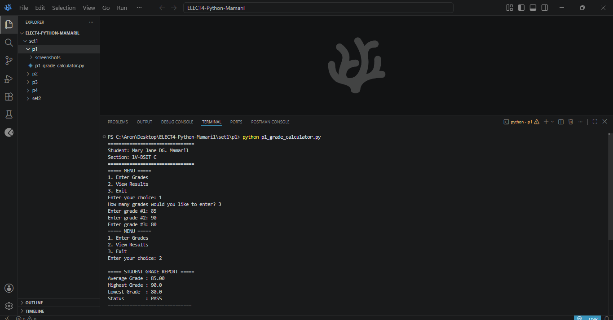
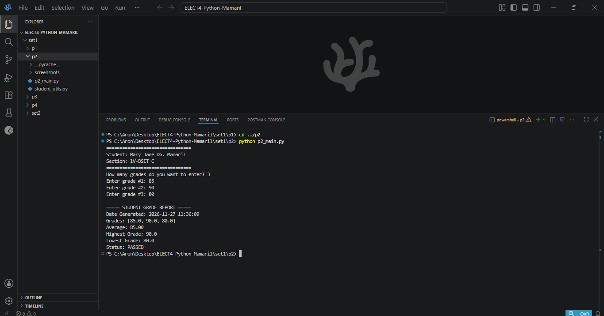

# ELEC 4 - Python Programming

**Name:** Mary Jane DG. Mamaril  
**Section:** IV-BSIT-C  
**Course:** ELEC 4 - Python Programming

## Set 1 Activities

### P1 - Student Grade Calculator

A menu-driven Python program that calculates the average, highest, lowest, and pass/fail status of student grades.

**Run:**
`python set1/p1/p1_grade_calculator.py`

**Screenshot:**

### P2 - Custom Module: student_utils

Uses a custom Python module and built-in modules to process student grades and generate a report.

**Run:**
`python set1/p2/p2_main.py`

**Screenshot:**

### P3 - Student Record Manager

Manages student names using Python lists and sets. Supports adding, removing, searching, displaying, and checking for duplicate students.

**Run:**
`python set1/p3/p3_record_manager.py`

**Screenshots:**

- [Add Students](set1/p3/screenshots/p3_add_students.png)
- [Duplicate Detection](set1/p3/screenshots/p3_duplicate.png)
- [Search Student](set1/p3/screenshots/p3_search.png)
- [Display Students](set1/p3/screenshots/p3_display.png)
- [Remove Student](set1/p3/screenshots/p3_remove_display.png)

### P4 - Safe Menu Program

Demonstrates Python exception handling for invalid inputs, division by zero, missing files, and invalid menu choices.

**Run:**
`python set1/p4/p4_exceptions.py`

**Screenshots:**

- [Invalid Number](set1/p4/screenshots/p4_invalid_number.png)
- [Division by Zero](set1/p4/screenshots/p4_division_by_zero.png)
- [Invalid Menu](set1/p4/screenshots/p4_invalid_menu.png)
- [Missing File](set1/p4/screenshots/p4_missing_file.png)
- [Valid Division](set1/p4/screenshots/p4_valid_division.png)

## Tools Used

- Python 3
- Visual Studio Code
- Git
- GitHub

## Testing

All four Python programs were tested using valid inputs and appropriate error-handling cases. Testing screenshots are included in their respective activity folders.